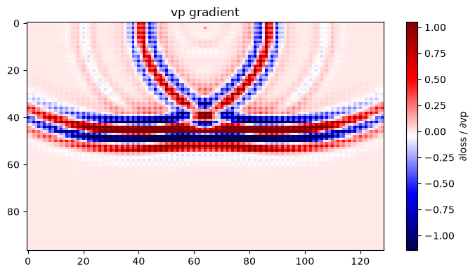
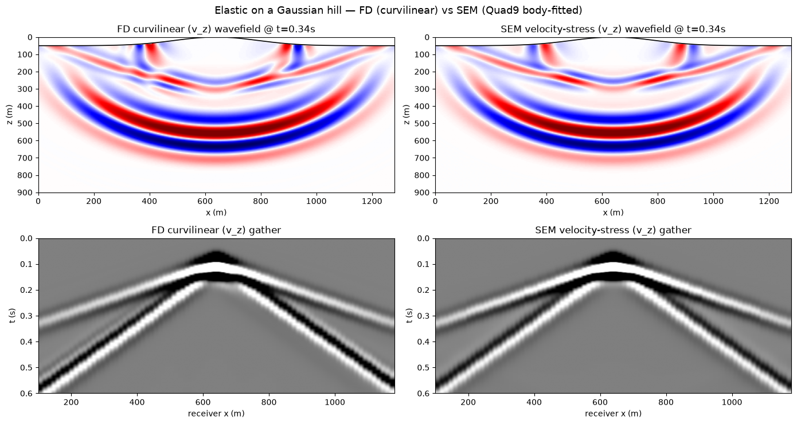
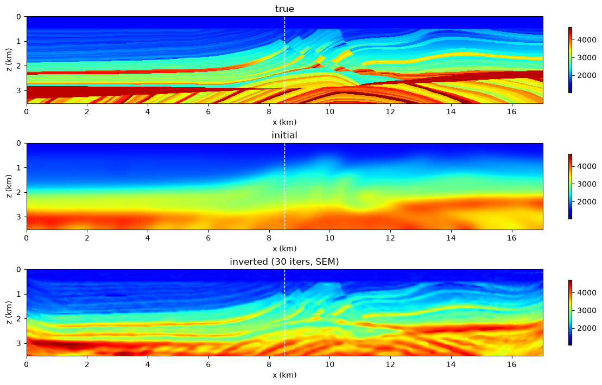
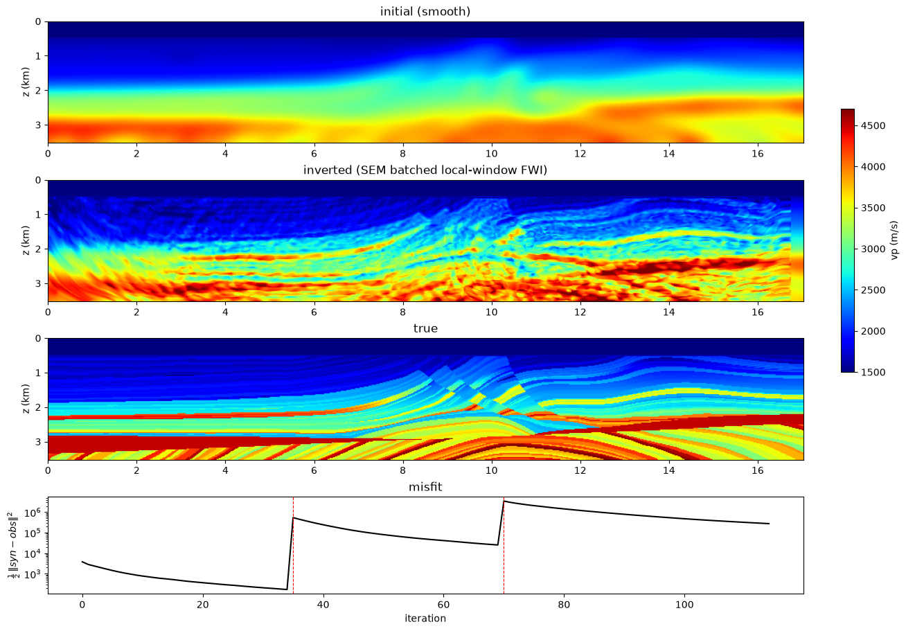

# SEM

The spectral-element solver, `sweep.sem.PropSEM`: `PropTorch`'s call on a
Quad9 mesh that follows the free surface. Forward and backward on a two-layer
model first, then topography against the finite-difference solvers, then FWI
on Marmousi, one model and every shot's window in one batched call. The
[SEM user guide](../../user-guide/sem.md) has the rest of the API.

-   { loading=lazy }

    **Hello · SEM · forward and backward**

    ---

    `PropSEM` on a two-layer model: one shot gather, then one `.backward()`
    for the vp gradient on the grid, with the full tape and with
    `memory=BoundarySaving()`.

    [:material-notebook-outline: Open notebook](../../notebooks/43_sem_forward_backward.ipynb)

-   { loading=lazy }

    **Wavefield · FD vs SEM on topography**

    ---

    The same Gaussian hill two ways: FD on the grid (the image method
    acoustic, the boundary-fitted curvilinear grid elastic) and SEM on a
    Quad9 mesh deformed to the surface, snapshots and gathers side by side.

    [:material-notebook-outline: Open notebook](../../notebooks/41_fd_vs_sem_topography.ipynb)

-   { loading=lazy }

    **FWI · Acoustic · Marmousi · SEM**

    ---

    The Marmousi workflow on the spectral-element solver: the grid is
    interpolated onto the GLL nodes and the gradient comes back on the grid.
    `impl='eager'` or `'c'`.

    [:material-notebook-outline: Open notebook](../../notebooks/42_fwi_acoustic_marmousi_sem.ipynb)

-   { loading=lazy }

    **FWI · Batched per-shot local windows · SEM**

    ---

    The SEM twin of the streamer example: every shot's window in one batched
    `PropSEM` call (`impl='c'`, `memory=BoundarySaving()`), frequency continuation
    from a smooth start.

    [:material-notebook-outline: Open notebook](../../notebooks/44_sem_batched_local_window_fwi.ipynb)

