# SEM

The spectral-element solver, `sweep.sem.PropSEM`: `PropTorch`'s call on a
Quad9 mesh that follows the free surface. Start with *Hello · SEM* for one
forward and one gradient, then the eight short *SEM basics* notebooks, each on
one part of the API, from the mesh to 3-D and to anisotropic and porous rocks.
The examples after them compare topography against the finite-difference
solvers, run FWI on Marmousi (one model and every shot's window in one batched
call), and then turn to marine receivers, illumination, attenuation and plane
waves. A model larger than one GPU holds runs across several with
`sweep.sem.dd`; the script page
[SEM · multi-GPU domain decomposition](../sem_dd.md) runs one 3-D shot that way.
The [SEM user guide](../../user-guide/sem.md) has the rest of the API.

## Basics

-   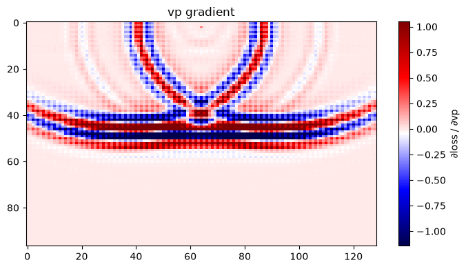{ loading=lazy }

    **Hello · SEM · forward and backward**

    ---

    `PropSEM` on a two-layer model: one shot gather, then one `.backward()`
    for the vp gradient on the grid, with the full tape and with
    `memory=BoundarySaving()`.

    [:material-notebook-outline: Open notebook](../../notebooks/43_sem_forward_backward.ipynb)

-   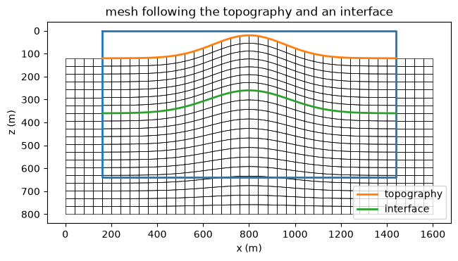{ loading=lazy }

    **Basics 1 · The mesh and the time step**

    ---

    The tiling rules for `shape` and `abcn`, `suggest_discretization` for `dh`
    and `dt`, `solver.mesh` with its elements and GLL nodes, a mesh that follows
    a topography and internal interfaces (`interfaces=`, `layered_model`), and
    what a too-large `dt` does.

    [:material-notebook-outline: Open notebook](../../notebooks/50_sem_mesh_and_time_step.ipynb)

-   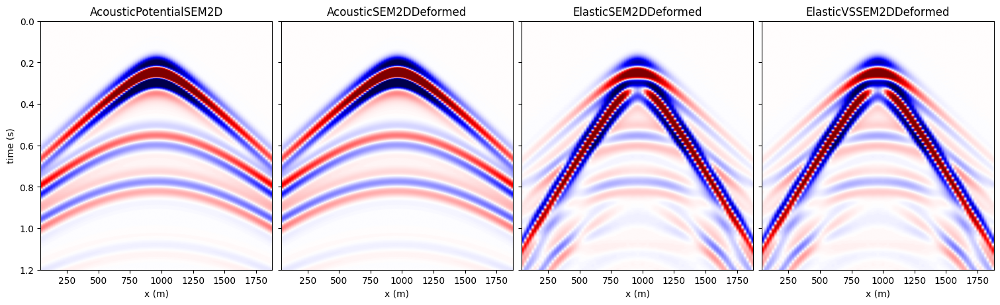{ loading=lazy }

    **Basics 2 · Choosing an equation**

    ---

    The equation table, what each equation takes as `models=` and which run on
    `impl='c'`, four 2-D equations on one model, record against record, and the
    SH equation.

    [:material-notebook-outline: Open notebook](../../notebooks/51_sem_equations_and_models.ipynb)

-   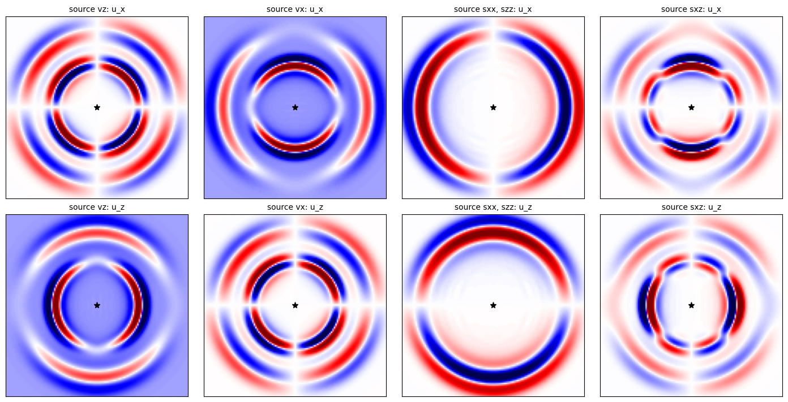{ loading=lazy }

    **Basics 3 · Sources, receivers and records**

    ---

    Grid-index positions, also between grid points, force, explosion and shear
    sources with their radiation, derived receiver components, and several shots
    with their own wavelets in one call.

    [:material-notebook-outline: Open notebook](../../notebooks/52_sem_sources_and_receivers.ipynb)

-   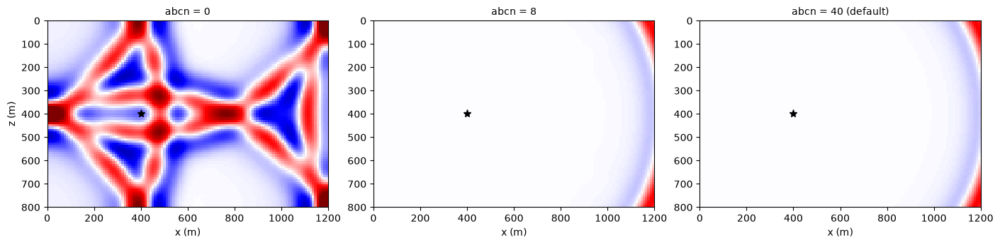{ loading=lazy }

    **Basics 4 · Boundaries and snapshots**

    ---

    `abcn` from none to the default, `free_surface` by edge, an elastic surface
    over a hill, wavefield snapshots, and the one refused C-PML layout.

    [:material-notebook-outline: Open notebook](../../notebooks/53_sem_boundaries_and_snapshots.ipynb)

-   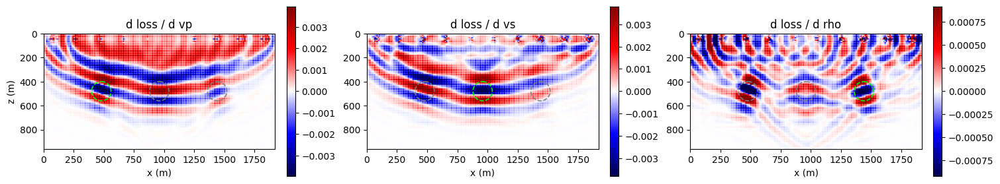{ loading=lazy }

    **Basics 5 · Gradients and memory**

    ---

    vp, vs and rho gradients from one multi-shot call, then `Full()`,
    `BoundarySaving()` and `Ckpt()` on both backends: time, peak memory and the
    gradient, the smaller rim-mode boundary saving, rings in bf16 and int8, and
    the same gradients on a velocity-stress class.

    [:material-notebook-outline: Open notebook](../../notebooks/54_sem_gradients_and_memory.ipynb)

-   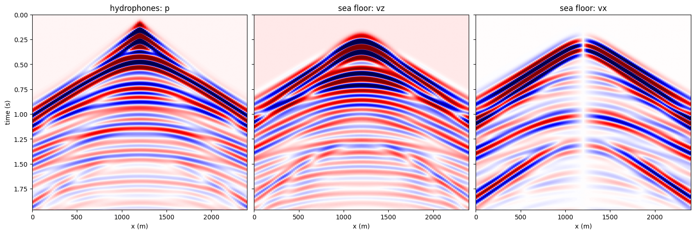{ loading=lazy }

    **Basics 6 · Water over an elastic sea floor**

    ---

    `AcousticElasticSEM2D` over a seamount: a mesh that follows the sea floor
    (`interfaces=`, `layered_model`), and pressure and particle velocity at
    hydrophones and ocean-bottom nodes in one call.

    [:material-notebook-outline: Open notebook](../../notebooks/55_sem_fluid_solid.ipynb)

-   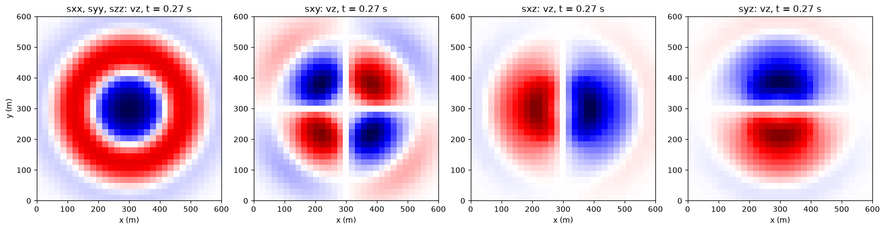{ loading=lazy }

    **Basics 7 · A 3-D model**

    ---

    Acoustic and elastic 3-D runs on `impl='c'`, moment-tensor sources, a 3-D
    topography, one 3-D gradient and a poroelastic rock: the same call with one
    more axis.

    [:material-notebook-outline: Open notebook](../../notebooks/56_sem_3d.ipynb)

-   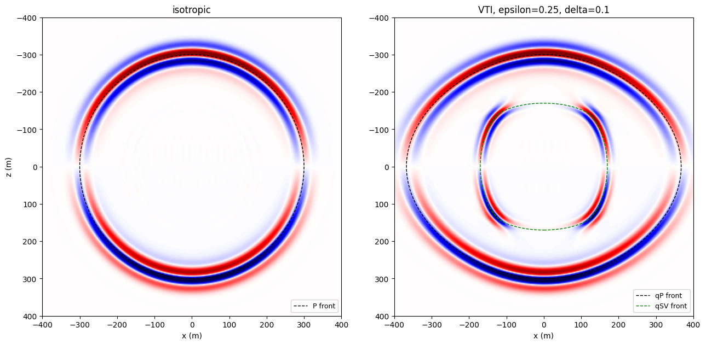{ loading=lazy }

    **Basics 8 · Anisotropic and poroelastic rocks**

    ---

    VTI and tilted TI with the Thomsen parameters, and Biot's porous rock with
    its slow P wave, anisotropic permeability, `equation_options` and an
    attenuating frame.

    [:material-notebook-outline: Open notebook](../../notebooks/57_sem_vti_and_biot.ipynb)

## Examples

-   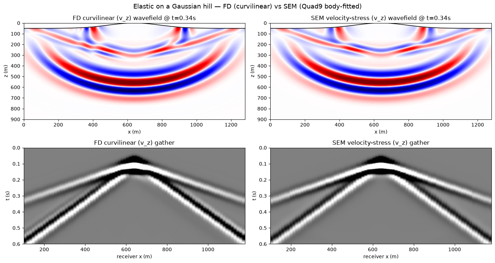{ loading=lazy }

    **Wavefield · FD vs SEM on topography**

    ---

    The same Gaussian hill two ways: FD on the grid (the image method
    acoustic, the boundary-fitted curvilinear grid elastic) and SEM on a
    Quad9 mesh deformed to the surface, snapshots and gathers side by side.

    [:material-notebook-outline: Open notebook](../../notebooks/41_fd_vs_sem_topography.ipynb)

-   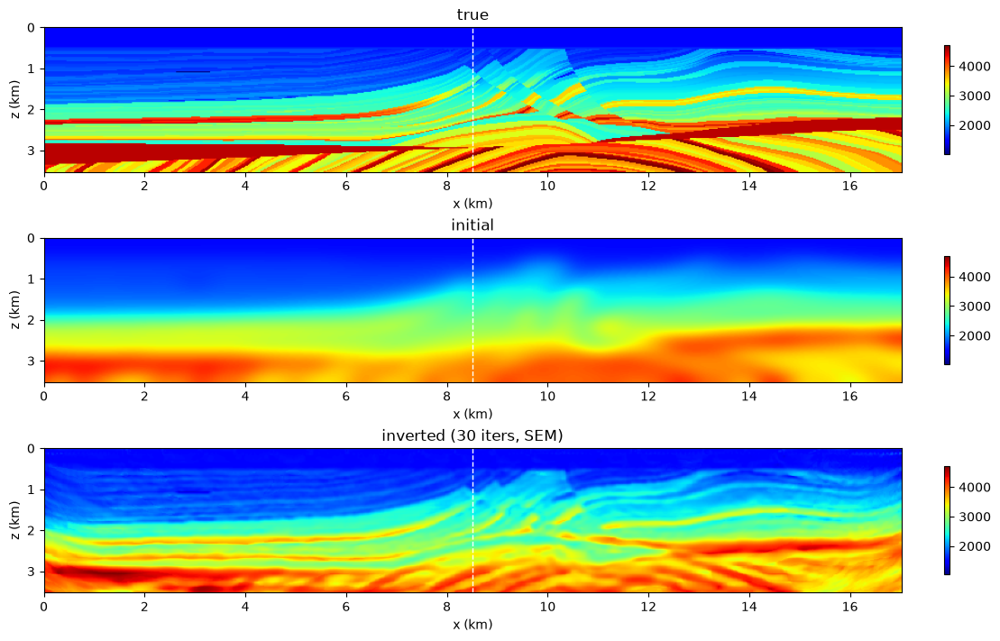{ loading=lazy }

    **FWI · Acoustic · Marmousi · SEM**

    ---

    The Marmousi workflow on the spectral-element solver: the grid is
    interpolated onto the GLL nodes and the gradient comes back on the grid.
    `impl='eager'` or `'c'`.

    [:material-notebook-outline: Open notebook](../../notebooks/42_fwi_acoustic_marmousi_sem.ipynb)

-   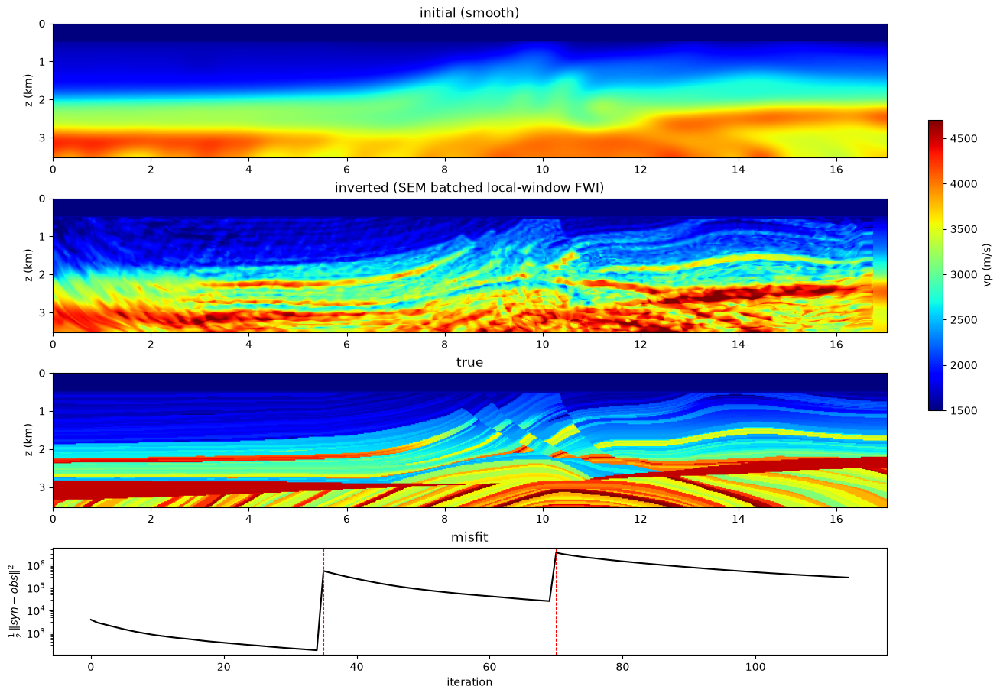{ loading=lazy }

    **FWI · Batched per-shot local windows · SEM**

    ---

    The SEM twin of the streamer example: every shot's window in one batched
    `PropSEM` call (`impl='c'`, `memory=BoundarySaving()`), frequency continuation
    from a smooth start.

    [:material-notebook-outline: Open notebook](../../notebooks/44_sem_batched_local_window_fwi.ipynb)

-   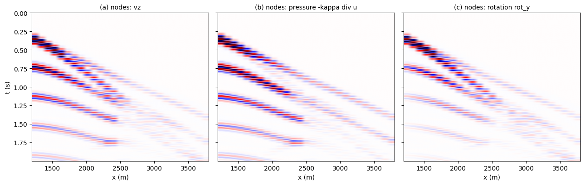{ loading=lazy }

    **Receivers · pressure, particle velocity, rotation, DAS**

    ---

    One marine run records every sensor where it sits: a dual-sensor streamer
    in the water, nodes on the sea floor (velocity, pressure, rotation) and a
    DAS fibre's strain rate, the gradient receivers checked against differences.

    [:material-notebook-outline: Open notebook](../../notebooks/47_sem_receivers.ipynb)

-   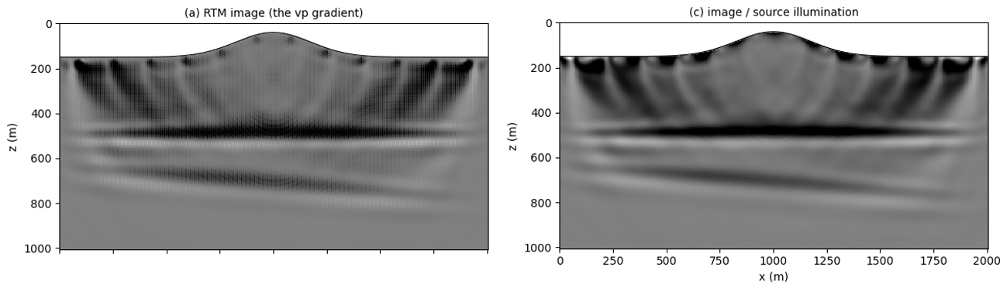{ loading=lazy }

    **Illumination · RTM under a hill**

    ---

    An RTM image under a hill, compensated by the source illumination
    (`compute_illumination`, the pseudo-Hessian), with the receiver
    illumination beside it.

    [:material-notebook-outline: Open notebook](../../notebooks/48_sem_illumination.ipynb)

-   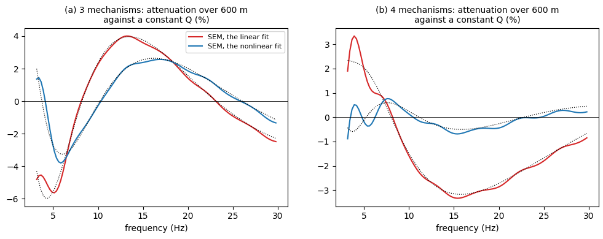{ loading=lazy }

    **Attenuation · Q fits, attenuating C-PML, 2-D visco classes**

    ---

    SPECFEM2D's nonlinear constant-Q fit (`fit="nonlinear"`) against the
    linear one, in Q(f) and in a strongly attenuated P wave, the absorbing
    layer that attenuates as the medium does, and the visco-acoustic and
    velocity-stress classes measured the same way.

    [:material-notebook-outline: Open notebook](../../notebooks/49_sem_attenuation.ipynb)

-   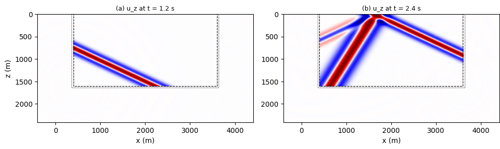{ loading=lazy }

    **Plane waves · P, SV, SH, Rayleigh through an injection band**

    ---

    SPECFEM2D's `initialfield` on the C-PML: a plane SV wave from below, past
    the critical angle, a Rayleigh wave, a P wave and an SH wave, entering
    through a band around a box, then a hill, a canyon and a soft basin inside it.

    [:material-notebook-outline: Open notebook](../../notebooks/58_sem_plane_wave.ipynb)

-   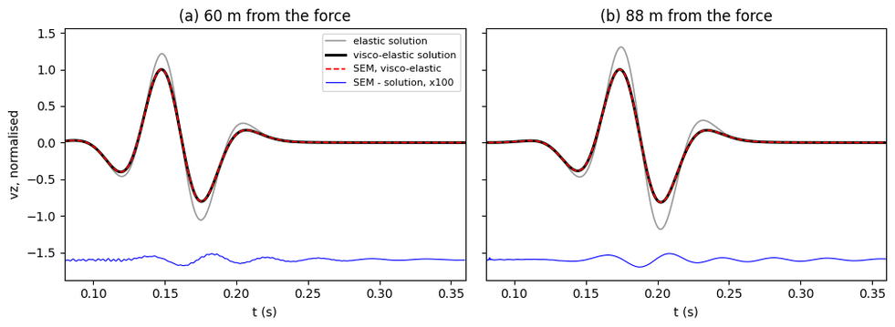{ loading=lazy }

    **Attenuation · visco-elastic in 3-D**

    ---

    `ViscoElasticVSSEM3D` against the whole-space visco-elastic Green's
    function of a point force, and `ViscoElasticVSSEM3DDeformed` under a hill:
    attenuation, a topography and absorbing boundaries together.

    [:material-notebook-outline: Open notebook](../../notebooks/59_sem_visco_elastic3d.ipynb)

-   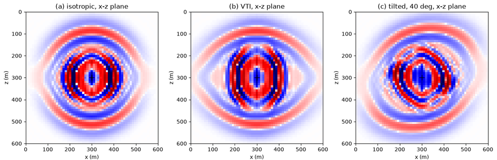{ loading=lazy }

    **Anisotropy · VTI and TTI in 3-D**

    ---

    `ElasticVTISEM3D` and `ElasticTTISEM3D`: the wavefronts of a point force in a VTI
    and a tilted medium, a shear wave splitting across a horizontal symmetry axis,
    and the deformed classes under a hill with a free surface.

    [:material-notebook-outline: Open notebook](../../notebooks/60_sem_tti3d.ipynb)

-   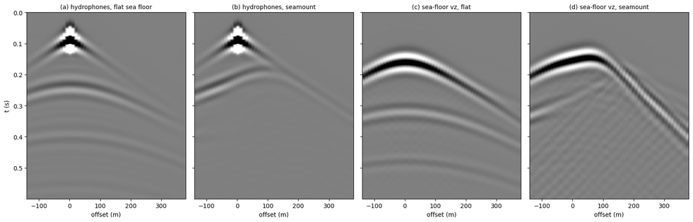{ loading=lazy }

    **Interfaces · a curved sea floor in 3-D**

    ---

    `PropSEM(interfaces=...)` on the Hex27 mesh: element layers that follow a
    seamount, water and rock in `BiotVSSEM3DDeformed`, an air gun recorded by
    hydrophones and sea-floor geophones.

    [:material-notebook-outline: Open notebook](../../notebooks/61_sem_seafloor3d.ipynb)

