# Symbolic PDEs

Equations written with `sweep.symbolic`: declare the models and fields, write one
equation per field, and `build()` an equation class that runs through
`PropTorch(impl="eager")` like a shipped one. Each notebook writes one PDE, runs one
batch of shots on a 2-D grid and animates the wavefield. The
[Symbolic PDEs user guide](../../user-guide/symbolic.md) covers what the DSL accepts.

## Second-order equations

-   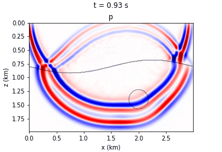{ loading=lazy }

    **Acoustic · free surface**

    ---

    `p_tt = vp² ∇²p` with a pressure-release surface, over a layer and a fast lens.

    [:material-notebook-outline: Open notebook](../../notebooks/70_symbolic_acoustic.ipynb)

-   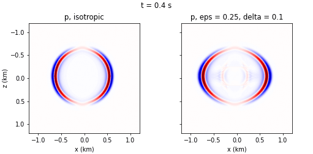{ loading=lazy }

    **Pseudo-acoustic VTI**

    ---

    Two coupled fields `p`, `q`; an isotropic and a VTI shot in one batch.

    [:material-notebook-outline: Open notebook](../../notebooks/71_symbolic_vti.ipynb)

-   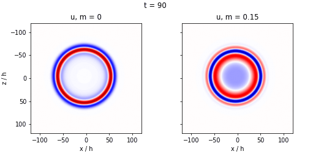{ loading=lazy }

    **Klein-Gordon**

    ---

    A mass term, `-m² u`, makes the waves dispersive; two masses in one batch.

    [:material-notebook-outline: Open notebook](../../notebooks/72_symbolic_klein_gordon.ipynb)

-   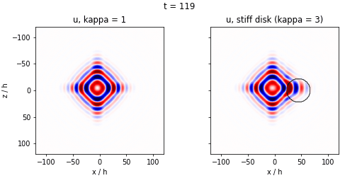{ loading=lazy }

    **Flexural waves · fourth derivatives**

    ---

    `u_tt = -κ (u_xxxx + u_zzzz)` with `u.dx4`, `u.dz4`; a stiff disk.

    [:material-notebook-outline: Open notebook](../../notebooks/73_symbolic_flexural.ipynb)

## First-order systems (staggered grid)

-   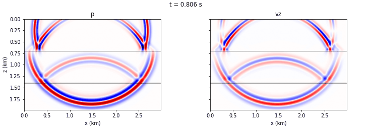{ loading=lazy }

    **Acoustic · pressure-velocity**

    ---

    The staggered first-order system; a density contrast alone reflects.

    [:material-notebook-outline: Open notebook](../../notebooks/74_symbolic_acoustic_first_order.ipynb)

-   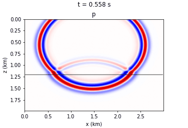{ loading=lazy }

    **Elliptic anisotropy**

    ---

    A different velocity along each axis gives an elliptical front.

    [:material-notebook-outline: Open notebook](../../notebooks/75_symbolic_elliptic_anisotropic.ipynb)

-   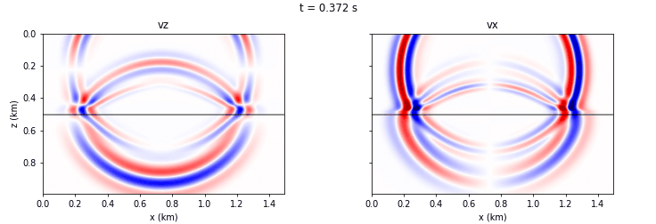{ loading=lazy }

    **Elastic · velocity-stress**

    ---

    Virieux's system with Lamé `Coefficient`s; P-S conversion at an interface.

    [:material-notebook-outline: Open notebook](../../notebooks/76_symbolic_elastic.ipynb)

-   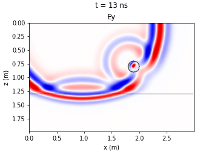{ loading=lazy }

    **Maxwell TM · ground-penetrating radar**

    ---

    `Ey`, `Hx`, `Hz` on a Yee grid; a wet layer and a buried pipe.

    [:material-notebook-outline: Open notebook](../../notebooks/77_symbolic_maxwell_tm.ipynb)

-   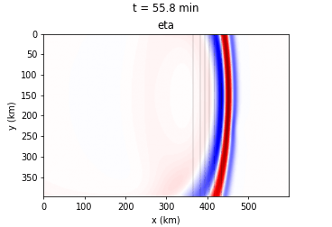{ loading=lazy }

    **Shallow water · tsunami**

    ---

    The linear long-wave equations; a wave slows and refracts on a shelf.

    [:material-notebook-outline: Open notebook](../../notebooks/78_symbolic_shallow_water.ipynb)

-   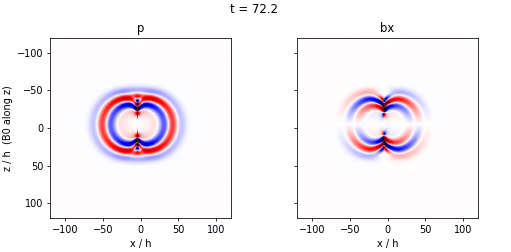{ loading=lazy }

    **Linear MHD**

    ---

    Ideal magnetohydrodynamics with a background field; anisotropic fronts and slow-mode cusps.

    [:material-notebook-outline: Open notebook](../../notebooks/79_symbolic_mhd.ipynb)

## Dissipative terms

-   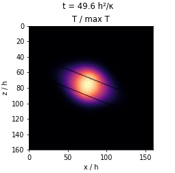{ loading=lazy }

    **Heat equation**

    ---

    `T_t = κ ∇²T` as a dissipative term; diffusion along a conductive strip.

    [:material-notebook-outline: Open notebook](../../notebooks/80_symbolic_heat.ipynb)

-   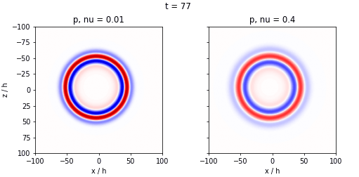{ loading=lazy }

    **Unsteady Stokes**

    ---

    Viscous flow with artificial compressibility; two viscosities in one batch.

    [:material-notebook-outline: Open notebook](../../notebooks/81_symbolic_stokes.ipynb)

